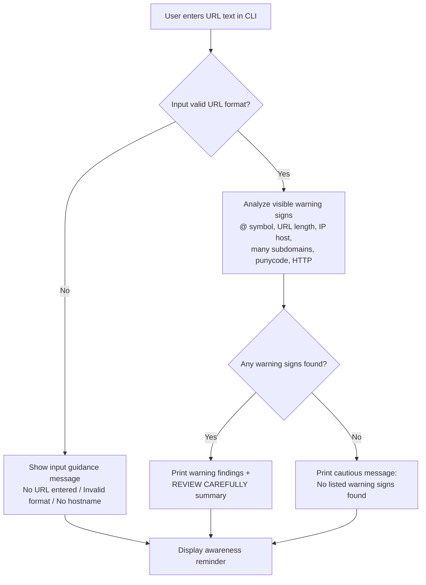

<p align="center">
  
</p>

<h1 align="center">Phishing URL Awareness Checker</h1>

<p align="center">
  
  
  
</p>

## Overview

Phishing uses deceptive messages and links to trick people into sharing private information. This beginner Python command-line project checks URL text for six visible warning signs and prints a cautious explanation. It never opens a link or contacts a website.

## Visual Flow



This flow diagram mirrors the current `phishing_checker.py` behavior: URL text is validated first, visible indicators are checked next, and the CLI always ends with guidance to stay cautious.

## Features

- Detects an `@` symbol in the URL
- Flags unusually long URLs (over 100 characters)
- Flags IP-address hostnames
- Flags hostnames with five or more dot-separated parts
- Flags punycode-style hostnames containing `xn--`
- Flags the HTTP scheme
- Lets you inspect multiple sample URLs in one run; type `q` to quit
- Handles malformed URL text without stopping unexpectedly
- Shows a **REVIEW CAREFULLY** summary when warning signs are found

## Requirements

Python 3.10 or later. No extra packages are needed.

## Run in VS Code

1. Open this folder in VS Code.
2. Open **Terminal → New Terminal**.
3. Run:

   ```powershell
   python phishing_checker.py
   ```

   On macOS or Linux, use `python3 phishing_checker.py`.
4. Enter a sample URL. Type `q` when you are finished.

## Example

```text
EWB Phishing URL Awareness Checker
Text checks only - this program does not open URLs.

Enter a sample URL (or type q to quit): http://192.0.2.10/account

Result:
- Uses an IP address instead of a familiar domain.
- Uses HTTP. HTTPS alone does not prove trust.

REVIEW CAREFULLY: 2 warning sign(s) found.
Never enter passwords from unexpected links.
```

## Testing

Run the automated test suite from this folder:

```powershell
python -m unittest discover -s tests -v
```

The tests cover the five workbook samples, malformed input, empty input, long
URLs, and the warning-summary logic. You can also use the manual cases in
[tests/test_samples.md](tests/test_samples.md) to practice the interactive
program.

## Screenshots

After running the program and recording your five sample results, save your own screenshots in the `screenshots` folder using these names:

- `sample_run.png` — terminal showing the command, sample input, and output
- `test_results.png` — your completed test table or the five terminal runs

## Improvements

1. **Repeat and quit:** the program accepts several URLs in one run and exits when you type `q`, `quit`, or `exit`.
2. **Safer input handling and clearer feedback:** malformed input produces a message instead of a traceback, and detected warning signs receive a review summary.

## Limitations

This is an educational tool. It only reads URL text. It does not visit URLs, scan for malware, check a reputation service, or prove that a URL is safe. **No listed warning signs found does NOT mean a URL is safe.** HTTPS also does not prove a site is honest.

## Ethical Use

Use the sample strings provided with this project. Do not enter passwords, collect credentials, open suspicious links, or use the project to deceive anyone or probe websites.

## Author

Add your name and course or batch here before publishing.
